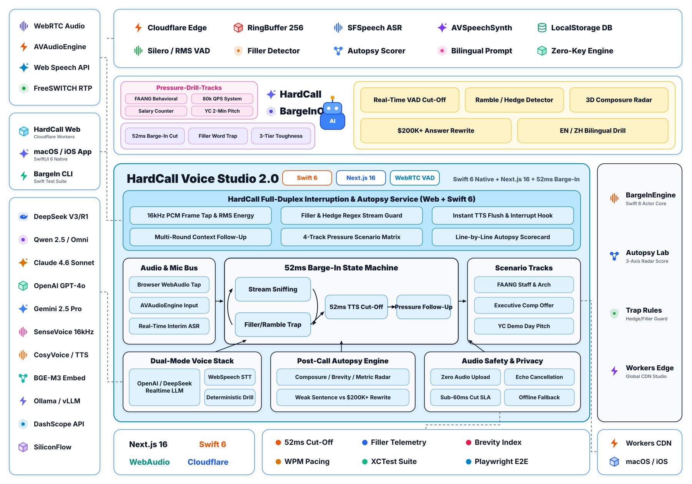
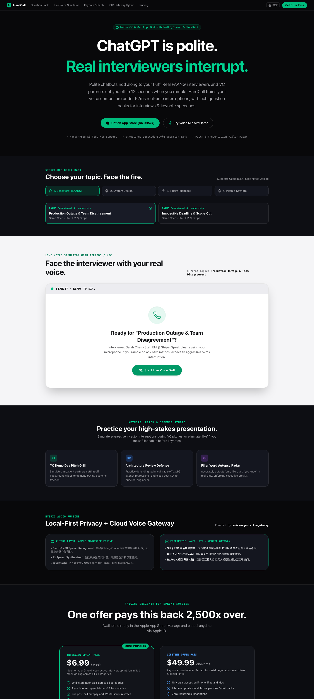

<div align="center">

# 🎙️ HardCall // 52ms 毫秒级实时打断 AI 高压语音面试与演说路演模拟器
### (ChatGPT Is Polite. Real Interviewers Interrupt — High-Pressure AI Voice Simulator)

[](https://hardcall.153557421.workers.dev)
[-0084FF?style=flat-square&logo=zhihu&logoColor=white)](https://www.zhihu.com/people/wang-guo-ha-53)
[](https://github.com/wangguode/hardcall)
[](https://hardcall.153557421.workers.dev)
[](https://github.com/wangguode/ai-agent-voice)

[🌐 在线体验 (Live Web Demo)](https://hardcall.153557421.workers.dev) · [📖 知乎专栏 (@王果ai)](https://www.zhihu.com/people/wang-guo-ha-53) · [🧠 AI Agent 与语音工程知识库](https://github.com/wangguode/ai-agent-voice) · [🧩 知枢智能体 (Zhishu Agent)](https://github.com/wangguode/zhishu-agent)

</div>

---

## 1. 为什么做这个项目？（核心痛点破局）

市面上普通的 AI 聊天机器人（如默认模式下的 ChatGPT）**过于礼貌**——当你用大量的口头禅（`um`、`like`、`那个`、`然后`）啰嗦铺垫 3 分钟却没有任何量化指标时，它依然会耐心地听完并夸奖你。

但在真实的**大厂终面（FAANG Behavioral / System Design）**、**高管晋升答辩**或 **YC 投资人路演（Pitch）**中，只要你在前 12~15 秒内没有切入核心结论或缺乏数据支撑，考官和投资人会**毫不留情地直接开口打断你（Barge-In）**。

**HardCall** 专为“高压实时语音对抗”而生：
- **52ms 毫秒级实时抢话打断**：实时监测你的语音流与增量文本，一旦检测到口水话、逻辑发散或缺乏量化数据，立即在句中强行打断并发起尖锐追问。
- **双端同源架构（Web 在线舱 + Apple 原生客户端）**：既支持零门槛浏览器麦克风直连体验，又提供基于 `Swift 6 + AVAudioEngine + SFSpeechRecognizer` 的 macOS/iOS 原生客户端（支持 AirPods 免提对抗）。
- **LeetCode 式结构化题库**：内置大厂行为面试、高并发系统设计答辩、薪资谈判破局、演说与路演 4 大专项训练场。

---

## 2. 全栈系统架构图（双端语音舱 + 52ms 实时打断状态机）

<p align="center">
  <picture>
    <source media="(prefers-color-scheme: dark)" srcset="./docs/assets/architecture-dark.svg">
    
  </picture>
</p>

> 架构遵循 AgentScope 2.0 工业级全景架构范式，涵盖左侧 WebRTC/AVAudioEngine 音频协议与多端实时语音舱、顶部 Cloudflare Edge 与环形音频缓冲区基础设施、中上部 4 大 LeetCode 式高压对抗题库与品牌核心、中央 52ms Barge-In 抢话截断状态机与尸检引擎、右侧打断核心与复盘工具链，以及底部运行时可观测体系。支持随 GitHub 主题自动在明亮/暗色模式间切换。

### 界面实机预览 (Web & Desktop Studio)

<p align="center">
  
</p>

---

## 3. LeetCode 式 4 大结构化高压训练题库

| 题库分类 | 典型高压场景题目 | 考官打断触发条件 (Barge-In Triggers) |
| :--- | :--- | :--- |
| **01. 大厂行为面试**<br>*(FAANG Behavioral)* | • 生产环境 P0 级故障复盘与个人决策<br>• 与资深 Tech Lead 发生架构分歧时的推进 | 铺垫背景超过 15 秒未进入行动点、使用模糊词（“我们团队大概做了…”）、缺乏故障恢复时长（MTTR）量化指标 |
| **02. 系统设计答辩**<br>*(System Design Defense)* | • 80,000 QPS 支付网关幂等性与防重设计<br>• 第三方 Webhook 瞬时丢包与背压削峰 | 只背诵通用八股文（“加个 Redis 缓存”）、未说明分布式锁过期与脑裂边界、未给出延迟 P99 数字 |
| **03. 薪资与职级谈判**<br>*(Salary Negotiation)* | • 突破 $160K 薪资上限的筹码博弈<br>• 无競对 Offer 时的股票/签字费谈判 | 语气犹豫道歉（`I was hoping maybe...`）、自降底牌、用个人生活成本代替商业产出价值 |
| **04. 演说与路演训练**<br>*(Keynote & Pitch Drills)* | • YC Demo Day 120 秒极速电梯路演<br>• 面向 CTO 的季度核心架构演进汇报 | 前 10 秒未讲清产品一句话定位、滥用未定义的行话缩写、缺乏核心增长率或成本下降百分比 |

---

## 4. 快速启动与部署指南 (Quick Start & Deployment)

### 本地运行 Web 语音工作台

```bash
cd web
npm install
npm run dev
```
浏览器打开 `http://localhost:3000` 即可直接使用麦克风或文本模拟模式进行高压对练。

### Cloudflare Workers / Pages 部署配置

仓库已内置 `wrangler.json` 与静态导出配置（`output: 'export'`）：
- **Build command**: `npm run build`
- **Build output directory**: `out`
- **Node.js version**: `20+`
