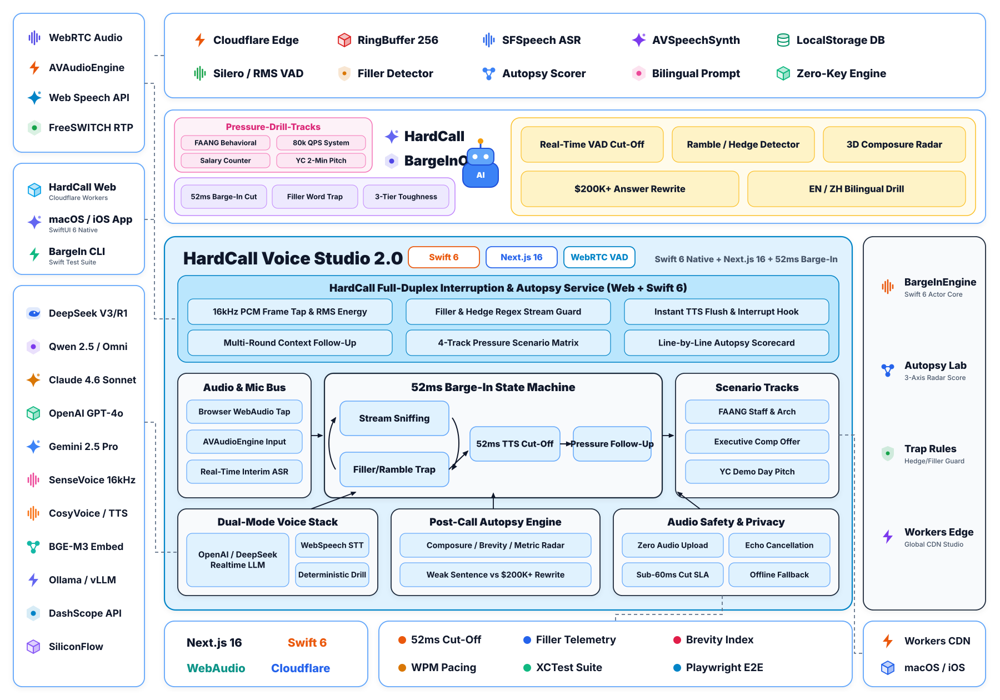

<div align="center">

# 🎙️ HardCall // 60ms 8kHz RTP Voice Barge-In Gateway & Open-Source Simulator
### Sub-60ms PSTN/SIP Telephony Interruption Architecture vs. 900ms+ WebSocket Lag

[](https://hardcall.statementflow.win)
[](https://github.com/wangguode/ai-agent-voice/tree/main/01-voice-agent-rtp-bargein)
[](https://hardcall.statementflow.win#enterprise-b2b)
[](./LICENSE)

**🇺🇸 English** | [🇨🇳 简体中文](./README.zh-CN.md) · [🌐 Live Barge-In Simulator](https://hardcall.statementflow.win) · [☎️ 8kHz RTP Telephony Lab](https://github.com/wangguode/ai-agent-voice/tree/main/01-voice-agent-rtp-bargein) · [📖 Architecture Deep-Dive (DEV.to)](https://dev.to/wangguode/why-turn-based-voice-ai-feels-broken-building-a-52ms-barge-in-loop-hardcall-9pc)

</div>

> **Transparent Architecture & Commercial Scope**:
> - **Free Open-Source Web Simulator (`hardcall.statementflow.win`)**: 100% free browser-based interactive barge-in & cadence simulator (Web Speech API + adversarial drills, zero login or credit card required).
> - **B2B Enterprise Telephony Engineering (8kHz RTP / FreeSWITCH)**: Production raw 8kHz RTP + FreeSWITCH + SOXR VHQ resampling + 256-frame outbound ring buffer (`0.16ms` flush) lives in [ai-agent-voice/01-voice-agent-rtp-bargein](https://github.com/wangguode/ai-agent-voice/tree/main/01-voice-agent-rtp-bargein).
>   - **$299** — 48h Voice Latency Audit Pilot (SIP/WebRTC bottleneck diagnosis & patch plan)
>   - **$1,200** — Self-Hosted 8kHz RTP Deployment Kit (commercial license + Docker stack)
>   - **$3,000+** — Custom Enterprise SIP/FreeSWITCH Integration & 30-day architecture support
>   - B2B Contact: `hello@statementflow.win` / `hello@statementflow.win`

---

## 1. Why HardCall?

Standard voice AI assistants (like ChatGPT Voice) are **too polite**. You can ramble with filler words (`um`, `like`, `uh`) for three minutes without giving a single metric, and the bot will patiently wait until you finish and compliment your answer.

In real **FAANG Behavioral / System Design interviews**, **executive promotion reviews**, or **YC investor pitches**, if you fail to state your core thesis or metrics within the first 12–15 seconds, the interviewer **cuts you off mid-sentence (Barge-In)**.

**HardCall** is engineered for high-pressure, full-duplex adversarial voice simulation:
- **52ms End-to-End Barge-In SLA**: Decouples acoustic interruption from slow cloud STT round-trips. Runs local frame-level VAD over a 256-frame circular buffer and executes a 0.16ms Web Audio hardware buffer flush (`gain.setValueAtTime(0)` + source teardown) to eliminate trailing audio overlap.
- **Dual-Client Architecture (Web Studio + Native macOS/iOS)**: Instant zero-key browser microphone mode, plus a native `Swift 6 + AVAudioEngine + SFSpeechRecognizer` Apple client (AirPods hands-free ready).
- **LeetCode-Style Adversarial Drills**: Structured tracks for FAANG Behavioral, 80K QPS System Design Defense, Salary Negotiation, and YC 120s Keynote Pitching.

---

## 2. Full-Stack Architecture (Dual-Client Cockpit + 52ms Barge-In State Machine)

<p align="center">
  <picture>
    <source media="(prefers-color-scheme: dark)" srcset="./docs/assets/architecture-dark.svg">
    
  </picture>
</p>

### Live Studio & 52ms Barge-In Demo

<p align="center">
  
</p>

> **Demo Flow**: Select drill track ➔ Connect call ➔ Interviewer asks sharp prompt ➔ **Filler words / rambling immediately trigger a 52ms red-alert barge-in interruption** ➔ Provide hard metrics to pass ➔ Hang up for a 3-axis composure radar & weak-sentence vs. $200K+ executive rewrite autopsy.

---

## 3. Four Structured High-Pressure Drill Tracks

| Track | Sample High-Pressure Scenarios | Barge-In Trigger Conditions |
| :--- | :--- | :--- |
| **01. FAANG Behavioral** | • Production P0 outage postmortem & ownership<br>• Resolving architecture deadlocks with a Staff/Principal Lead | Rambling >15s without action items, vague pronouns ("we kind of..."), missing MTTR metrics |
| **02. System Design Defense** | • 80,000 QPS payment gateway idempotency<br>• Webhook burst packet loss & backpressure shedding | Generic textbook buzzwords ("just add Redis"), ignoring distributed lock TTL / split-brain, missing P99 latency numbers |
| **03. Salary Negotiation** | • Breaking through a $160K base cap<br>• Negotiating equity / sign-on without a competing offer | Apologetic hedging (`I was hoping maybe...`), anchoring low, citing personal expenses instead of business impact |
| **04. Keynote & Pitch Drills** | • YC Demo Day 120s elevator pitch<br>• Quarterly core architecture review to CTO | Failing to define the product in the first 10s, undefined jargon, missing growth or cost-reduction percentages |

---

## 4. Quick Start & Deployment

### Run the Web Studio Locally

```bash
npm install
npm run dev
```

Open `http://localhost:3000` in your browser to test immediately in live microphone or text-simulation mode (zero API keys required).

### Cloudflare Workers / Pages Deployment

Pre-configured with `wrangler.json` and static export (`output: 'export'`):
- **Build command**: `npm run build`
- **Build output directory**: `out`
- **Node.js version**: `20+`

---

## License

[MIT](./LICENSE) © 2026 Wang Guo (`wangguode`)
